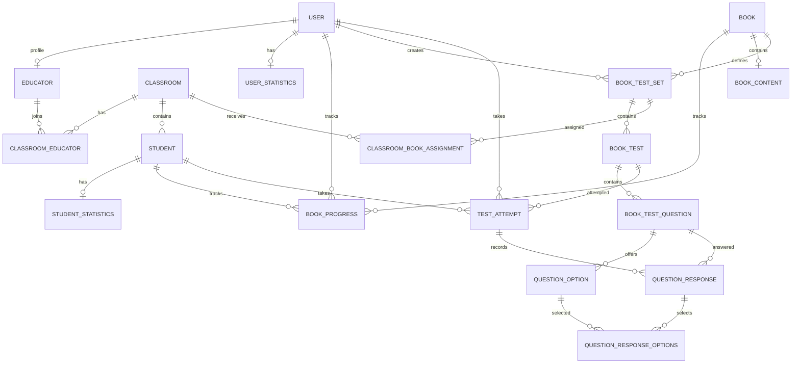

# Database model

This document describes the SQLAlchemy schema in `app/models.py`. It is a reference to the current prototype, not a claim that every workflow or access rule is implemented in the web application. The committed Alembic/Flask-Migrate revisions in `migrations/` are the authoritative schema history; change the models through reviewed migrations.

## Technology and lifecycle

- ORM: Flask-SQLAlchemy / SQLAlchemy.
- Local database: SQLite, configured by `SQLALCHEMY_DATABASE_URI = 'sqlite:///database.db'` in `app/app.py`. The relative SQLite file is normally `app/instance/database.db`.
- Schema changes: Flask-Migrate (Alembic), with revisions under `migrations/versions/`.
- The database file is local, mutable data; it is not the schema and should not be committed. Migrations are source code and should be committed.

## Relationship overview



`TestAttempt` and `BookProgress` each use nullable user/student foreign keys plus a check constraint requiring exactly one learner identity per row. A test attempt may also refer to the classroom assignment through which it was taken.

## Accounts and classrooms

### `users`

Accounts for public users, educators, and administrators. The row stores name, unique email, role, and password hash. `role` is the account-level `USER`/`ADMIN` enum; it is not the same as classroom membership.

- `UserStatistics` is an optional one-to-one aggregate row, keyed by `user_id`.
- `Educator` is an optional educator profile, also keyed by `user_id`.
- `ClassroomEducator` connects an educator profile to a classroom. Its composite primary key `(educator_user_id, classroom_id)` prevents duplicate memberships.
- `created_test_sets` identifies test sets authored by the account. A nullable creator foreign key allows a set to remain if its creator account is removed.
- `book_progress` and `test_attempts` record learner activity.

`ClassroomRole` is declared in the model but is not currently stored or used. If a user can have a different role in each classroom, that role belongs on the membership row rather than on the global account.

### `classrooms` and `students`

A classroom contains students and educator memberships. A classroom can receive multiple `ClassroomBookAssignment` rows. Each student is required to belong to one classroom.

Student PINs are strings so leading zeroes can be retained. A uniqueness constraint scopes PIN uniqueness to a classroom, and a length check requires four characters. The database constraint does not verify that those characters are digits; that must be validated in application input. A four-digit PIN is weak authentication and needs rate limiting.

`StudentStatistics` is an optional one-to-one aggregate row. `BookProgress` and `TestAttempt` can each belong to a student.

## Books and reading progress

### `books` and `book_content`

`Book` stores catalogue metadata: title, author, year, page count, and availability. `BookContent` stores the text separately and is one-to-one with a book (`book_id` is unique). Large content is represented as text, not as a collection of chapters or blocks in the current schema.

### `book_progress`

A progress row belongs to exactly one user or one student and to one book. Unique constraints allow at most one progress row per learner/book pair. Currently it stores only `current_page`; it is separate from test results and does not yet capture reading sessions or a character-level position.

`UserStatistics` and `StudentStatistics` are aggregate reading-statistics tables. They do not replace `TestAttempt` or `QuestionResponse`. The field `average_book_difficulty` uses a categorical difficulty enum, so the exact meaning of “average” remains a product decision.

## Test authoring

### `book_test_sets`

A test set belongs to exactly one book and has a name, optional creator, visibility (`PRIVATE`/`PUBLIC`), and publication state. A set can contain multiple tests. Visibility and publication fields describe the data, but application code must enforce who may view, edit, publish, or assign a set.

### `book_tests`

Every test belongs to one test set. `position` is its ordering in the set/editor. `placement` describes where the test appears in the book:

- `INLINE` requires a non-negative `start_char_index`.
- `END_OF_BOOK` requires `start_char_index` to be null.

A character offset depends on the exact text. If book content can be edited, placements need a stable content version or a more durable chapter/block anchor. The schema currently has no content-version table.

### `book_test_questions` and `question_options`

A test contains ordered questions. A question stores its prompt, question type, optional soundbite audio URL and secondary prompt, and answer type. Each selectable option belongs to one question, has a position, and carries an `is_correct` flag.

Correctness flags are answer-key data. Student-facing endpoints must omit them until grading is complete. The schema has not yet added dedicated structures for robust free-answer, drag-and-drop, or speaking rubrics/submissions; those are future work. Although answer-type enum values exist, application validation and grading behavior are still needed for each type.

## Classroom assignments and access

### `classroom_book_assignments`

An assignment links a classroom to a test set, with the assigning user and an `is_active` flag. The book is obtained from `assignment.test_set.book`; it is not duplicated on the assignment row. Multiple assignments may be active for one classroom. The current schema does not prevent duplicate active assignments or enforce that the assigning user is an educator in that classroom.

A student should receive only published test sets assigned to their own classroom. Server-side access checks must verify classroom membership and ownership/visibility rules; a foreign key or `PUBLIC` visibility value alone does not grant authorization.

## Test-taking data

### `test_attempts`

One row represents one learner's run of one test. It records exactly one user or student, the test, an optional classroom assignment, status (`IN_PROGRESS`, `COMPLETED`, or `ABANDONED`), start time, and optional completion time. A learner taking a test again should get a new attempt row.

### `question_responses`

A response belongs to an attempt and a test question. A unique constraint on `(attempt_id, question_id)` allows one current response per question per attempt. It stores response status, free-text/audio fields, grading state, correctness, points, and answer time. For single/multiple choice, selected options are linked through `question_response_options` rather than copied into JSON.

Correct/wrong totals can be calculated from responses (`is_correct=True`/`False`); unanswered, skipped, and pending-review states are represented separately. If summary scores/counts are added to `TestAttempt` for reporting, update them transactionally from response rows. The application must ensure the response question belongs to the attempt's test and selected options belong to that question; the current foreign keys do not enforce those cross-table conditions.

## Important integrity and deletion notes

- ORM `cascade` settings govern SQLAlchemy relationship operations. Foreign-key `ondelete` rules are enforced by the database.
- SQLite does not enforce foreign keys by default. The app should enable `PRAGMA foreign_keys=ON` on every SQLite connection before relying on database-level `ON DELETE CASCADE`, `RESTRICT`, or `SET NULL`, especially where `passive_deletes=True` is configured. Verify this behavior with tests.
- Owned dependents such as test questions/options and attempt responses use delete-orphan cascades. Books are restricted from deletion when test sets or progress refer to them; archiving is safer than deleting educational history.
- Test attempts restrict deletion of referenced users/students and tests, preserving historical results. Plan account/student archival or anonymization rather than assuming hard deletes will succeed.
- `BookProgress`, statistics, attempts, and responses are different records with different lifecycles; do not derive a detailed test history from aggregate statistics.

## Migration workflow

From the repository root:

```shell
python -m flask --app app/app.py db current
python -m flask --app app/app.py db migrate -m "describe schema change"
# Review migrations/versions/<new revision>.py
python -m flask --app app/app.py db upgrade
```

For fresh local setup, use `db upgrade` to apply the revisions already in the repository. `db init` is only for creating a migration repository when none exists; it is not part of the normal setup. See [Getting started](getting-started.md).
